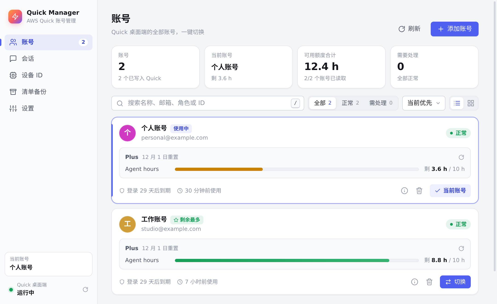
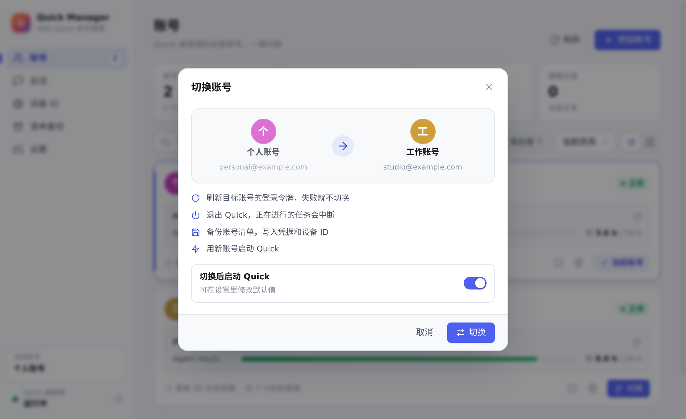
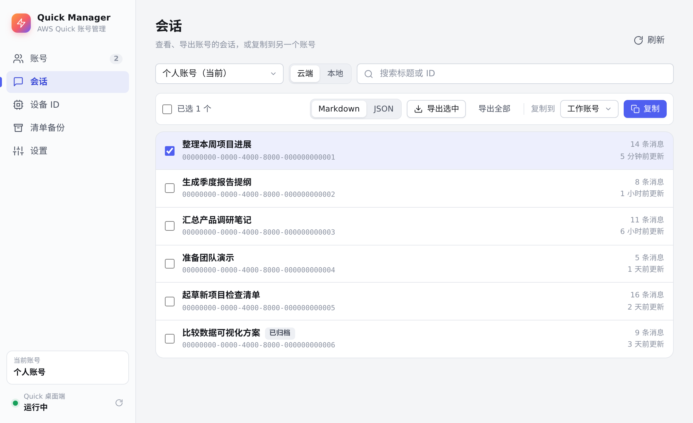

[English](README.md) | [中文](README.zh-CN.md)

# AWS Quick Manager

A multi-account tool for the **Amazon Quick desktop app** on Windows and macOS. Unofficial, not affiliated with Amazon Web Services.

## One-click account switching

The Quick desktop app can already keep several accounts on one computer, but its UI only lets you sign out, not switch. This tool switches Quick to another account in one click. It first refreshes the target account's tokens and stops if that fails. Then it quits Quick, backs up the account list, writes the target's sign-in, points `last_active` at it, and starts Quick again. Each account keeps its own local data and device identity, so switching back finds everything where you left it. Adding an account doesn't sign Quick out either: sign in through the browser, or import accounts already signed in to Quick.

## Cross-account session import

Quick keeps chat history in the cloud, per account. The local `sessions.db` is only a mirror, so after a switch the old sessions can't be opened, and copying local files doesn't help. This tool goes through Quick's own cloud API instead. It gets the account's SNCS token from Quick's bundled backend (`quickwork-agent --outpost-only`), then calls the `invokeAgent` endpoint the same way the desktop app does: it reads the session's raw events from the source account, creates a new session on the target, and uploads the rewritten events one by one. If the copy fails, the incomplete session is deleted. The source session is only read, never changed. Attachments and workspace files are not copied.

## Other features

- Account list with the agent hours left shown on each card
- Export sessions as Markdown or JSON
- A separate device ID per account, which you can replace or restore
- Automatic backup of the account list before each switch, restorable at any time
- Tray icon, launch at login, light / dark theme
- Command line: `aqm list`, `aqm current`, `aqm switch <index|email|id>`

Reverse proxy and API forwarding are out of scope; use [magpie-aws-quick](https://github.com/httpdone/magpie-aws-quick) for that.

## Screenshots

The screenshots show the Chinese UI with sample data.

**Account overview and remaining Agent hours**



**Switching accounts**



**Session export and cross-account copy**



## Development

Requires Node ≥ 22, pnpm and Rust.

```bash
pnpm install
pnpm tauri dev
cd src-tauri && cargo test
```

## Community

Questions, bug reports, suggestions, or want to tinker together? Issues and
pull requests are very welcome — **[linux.do](https://linux.do)** is the
best place to find me and the community around this project.

## License

MIT
